# Diagrama de clases y métodos del sistema de alquiler de prendas

La documentación corresponde al backend Spring Boot de ProyectoAlquiler. Las flechas muestran asociaciones JPA, herencia, implementación de interfaces y dependencias declaradas. Las firmas corresponden a métodos escritos en el código. Lombok genera los accesores y constructores de las clases anotadas.

## Entidades y cardinalidades

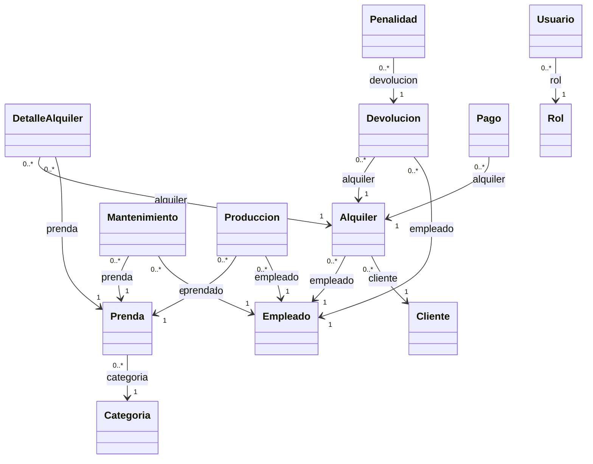

## Contratos genéricos de persistencia y servicio

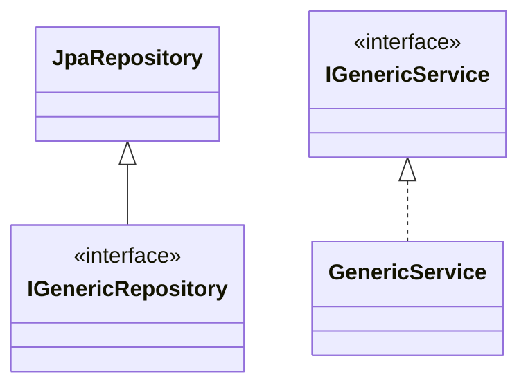

### IGenericRepository

Sin campos ni métodos propios declarados.

### IGenericService

| Método declarado | Retorno |
|---|---|
| `save(T t)` | `T` |
| `update(ID id, T t)` | `T` |
| `findAll()` | `List<T>` |
| `findById(ID id)` | `T` |
| `delete(ID id)` | `void` |

### GenericService

| Método declarado | Retorno |
|---|---|
| `getRepo()` | `IGenericRepository<T, ID>` |
| `save(T t)` | `T` |
| `update(ID id, T t)` | `T` |
| `findAll()` | `List<T>` |
| `findById(ID id)` | `T` |
| `delete(ID id)` | `void` |

## Módulo de Alquiler

### Alquiler

| Campo | Tipo |
|---|---|
| `idAlquiler` | `Integer` |
| `fechaAlquiler` | `LocalDate` |
| `fechaInicio` | `LocalDate` |
| `fechaFin` | `LocalDate` |
| `estado` | `String` |
| `subtotal` | `BigDecimal` |
| `total` | `BigDecimal` |
| `detalles` | `List<DetalleAlquiler>` |
| `pagos` | `List<Pago>` |
| `devoluciones` | `List<Devolucion>` |
| `empleado` | `Empleado` |
| `cliente` | `Cliente` |

### AlquilerDto

| Campo | Tipo |
|---|---|
| `idAlquiler` | `Integer` |
| `fechaAlquiler` | `LocalDate` |
| `fechaInicio` | `LocalDate` |
| `fechaFin` | `LocalDate` |
| `estado` | `String` |
| `subtotal` | `BigDecimal` |
| `total` | `BigDecimal` |
| `empleadoId` | `Integer` |
| `clienteId` | `Integer` |
| `nombreEmpleado` | `String` |
| `nombreCliente` | `String` |
| `apellidoCliente` | `String` |

### AlquilerController

| Campo | Tipo |
|---|---|
| `service` | `IAlquilerService` |
| `modelMapper` | `ModelMapper` |

| Método declarado | Retorno |
|---|---|
| `findAll()` | `ResponseEntity<List<AlquilerDto>>` |
| `findById(Integer id)` | `ResponseEntity<AlquilerDto>` |
| `save(AlquilerDto alquiler)` | `ResponseEntity<AlquilerDto>` |
| `update(Integer id, AlquilerDto alquiler)` | `ResponseEntity<AlquilerDto>` |
| `deleteById(Integer id)` | `ResponseEntity<Void>` |

### IAlquilerService

Sin campos ni métodos propios declarados.

### AlquilerService

| Campo | Tipo |
|---|---|
| `repo` | `IAlquilerRepository` |

| Método declarado | Retorno |
|---|---|
| `getRepo()` | `IGenericRepository<Alquiler, Integer>` |

### IAlquilerRepository

Sin campos ni métodos propios declarados.

## Módulo de Categoria

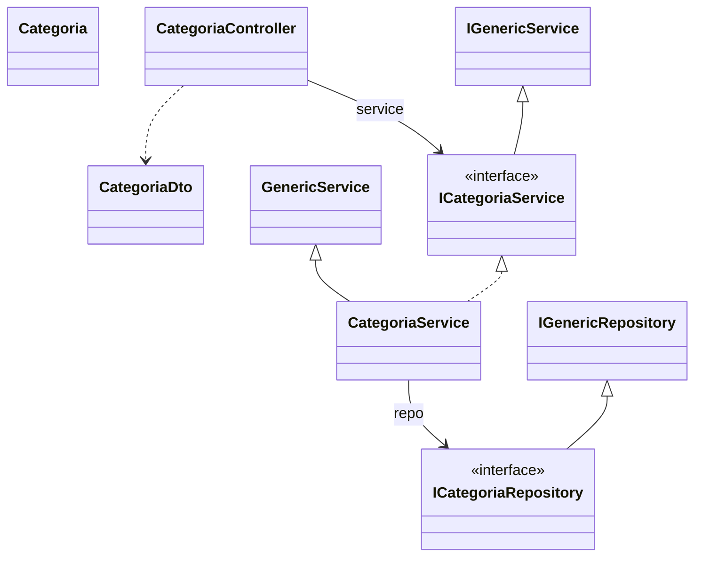

### Categoria

| Campo | Tipo |
|---|---|
| `idCategoria` | `Integer` |
| `nombre` | `String` |
| `descripcion` | `String` |
| `estado` | `String` |
| `prendas` | `List<Prenda>` |

### CategoriaDto

| Campo | Tipo |
|---|---|
| `idCategoria` | `Integer` |
| `nombre` | `String` |
| `descripcion` | `String` |
| `estado` | `String` |

### CategoriaController

| Campo | Tipo |
|---|---|
| `service` | `ICategoriaService` |
| `modelMapper` | `ModelMapper` |

| Método declarado | Retorno |
|---|---|
| `findAll()` | `ResponseEntity<List<CategoriaDto>>` |
| `findById(Integer id)` | `ResponseEntity<CategoriaDto>` |
| `save(CategoriaDto categoria)` | `ResponseEntity<CategoriaDto>` |
| `update(Integer id, CategoriaDto categoria)` | `ResponseEntity<CategoriaDto>` |
| `deleteById(Integer id)` | `ResponseEntity<Void>` |

### ICategoriaService

Sin campos ni métodos propios declarados.

### CategoriaService

| Campo | Tipo |
|---|---|
| `repo` | `ICategoriaRepository` |

| Método declarado | Retorno |
|---|---|
| `getRepo()` | `IGenericRepository<Categoria, Integer>` |

### ICategoriaRepository

Sin campos ni métodos propios declarados.

## Módulo de Cliente

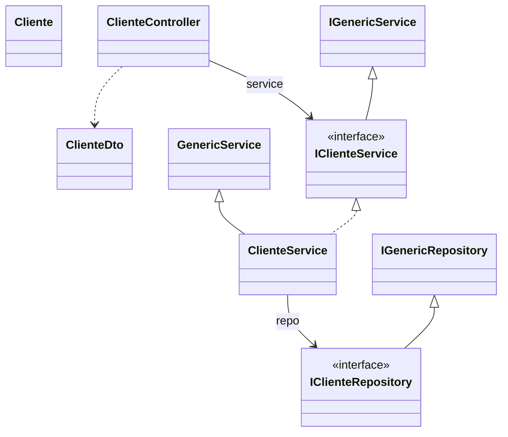

### Cliente

| Campo | Tipo |
|---|---|
| `idCliente` | `Integer` |
| `nombre` | `String` |
| `apellidos` | `String` |
| `dni` | `String` |
| `telefono` | `String` |
| `direccion` | `String` |
| `correo` | `String` |
| `alquileres` | `List<Alquiler>` |

### ClienteDto

| Campo | Tipo |
|---|---|
| `idCliente` | `Integer` |
| `nombre` | `String` |
| `apellidos` | `String` |
| `dni` | `String` |
| `telefono` | `String` |
| `direccion` | `String` |
| `correo` | `String` |

### ClienteController

| Campo | Tipo |
|---|---|
| `service` | `IClienteService` |
| `modelMapper` | `ModelMapper` |

| Método declarado | Retorno |
|---|---|
| `findAll()` | `ResponseEntity<List<ClienteDto>>` |
| `findById(Integer id)` | `ResponseEntity<ClienteDto>` |
| `save(ClienteDto cliente)` | `ResponseEntity<ClienteDto>` |
| `update(Integer id, ClienteDto cliente)` | `ResponseEntity<ClienteDto>` |
| `deleteById(Integer id)` | `ResponseEntity<Void>` |

### IClienteService

Sin campos ni métodos propios declarados.

### ClienteService

| Campo | Tipo |
|---|---|
| `repo` | `IClienteRepository` |

| Método declarado | Retorno |
|---|---|
| `getRepo()` | `IGenericRepository<Cliente, Integer>` |

### IClienteRepository

Sin campos ni métodos propios declarados.

## Módulo de DetalleAlquiler

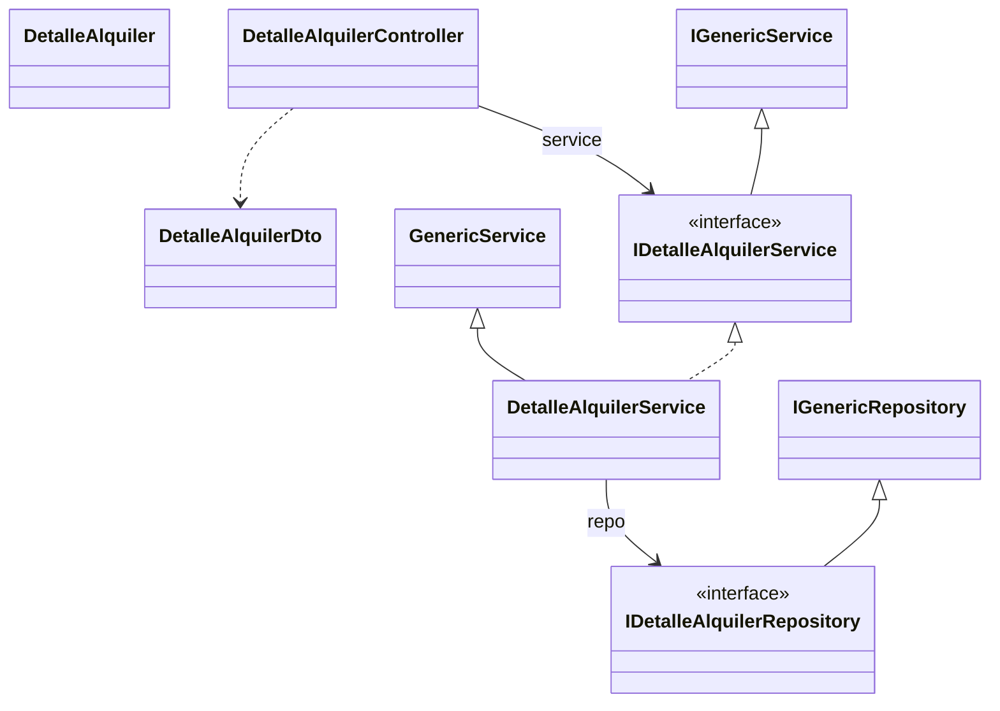

### DetalleAlquiler

| Campo | Tipo |
|---|---|
| `idDetalle` | `Integer` |
| `cantidad` | `int` |
| `precioUnitario` | `BigDecimal` |
| `subtotal` | `BigDecimal` |
| `alquiler` | `Alquiler` |
| `prenda` | `Prenda` |

### DetalleAlquilerDto

| Campo | Tipo |
|---|---|
| `idDetalle` | `Integer` |
| `cantidad` | `int` |
| `precioUnitario` | `BigDecimal` |
| `subtotal` | `BigDecimal` |
| `alquilerId` | `Integer` |
| `prendaId` | `Integer` |

### DetalleAlquilerController

| Campo | Tipo |
|---|---|
| `service` | `IDetalleAlquilerService` |
| `modelMapper` | `ModelMapper` |

| Método declarado | Retorno |
|---|---|
| `findAll()` | `ResponseEntity<List<DetalleAlquilerDto>>` |
| `findById(Integer id)` | `ResponseEntity<DetalleAlquilerDto>` |
| `save(DetalleAlquilerDto detalleAlquiler)` | `ResponseEntity<DetalleAlquilerDto>` |
| `update(Integer id, DetalleAlquilerDto detalleAlquiler)` | `ResponseEntity<DetalleAlquilerDto>` |
| `deleteById(Integer id)` | `ResponseEntity<Void>` |

### IDetalleAlquilerService

Sin campos ni métodos propios declarados.

### DetalleAlquilerService

| Campo | Tipo |
|---|---|
| `repo` | `IDetalleAlquilerRepository` |

| Método declarado | Retorno |
|---|---|
| `getRepo()` | `IGenericRepository<DetalleAlquiler, Integer>` |

### IDetalleAlquilerRepository

Sin campos ni métodos propios declarados.

## Módulo de Devolucion

### Devolucion

| Campo | Tipo |
|---|---|
| `idDevolucion` | `Integer` |
| `fechaDevolucion` | `LocalDateTime` |
| `estadoPrenda` | `String` |
| `observacion` | `String` |
| `alquiler` | `Alquiler` |
| `empleado` | `Empleado` |
| `penalidades` | `List<Penalidad>` |

### DevolucionDto

| Campo | Tipo |
|---|---|
| `idDevolucion` | `Integer` |
| `fechaDevolucion` | `LocalDateTime` |
| `estadoPrenda` | `String` |
| `observacion` | `String` |
| `alquilerId` | `Integer` |
| `empleadoId` | `Integer` |

### DevolucionController

| Campo | Tipo |
|---|---|
| `service` | `IDevolucionService` |
| `modelMapper` | `ModelMapper` |

| Método declarado | Retorno |
|---|---|
| `findAll()` | `ResponseEntity<List<DevolucionDto>>` |
| `findById(Integer id)` | `ResponseEntity<DevolucionDto>` |
| `save(DevolucionDto devolucion)` | `ResponseEntity<DevolucionDto>` |
| `update(Integer id, DevolucionDto devolucion)` | `ResponseEntity<DevolucionDto>` |
| `deleteById(Integer id)` | `ResponseEntity<Void>` |

### IDevolucionService

Sin campos ni métodos propios declarados.

### DevolucionService

| Campo | Tipo |
|---|---|
| `repo` | `IDevolucionRepository` |

| Método declarado | Retorno |
|---|---|
| `getRepo()` | `IGenericRepository<Devolucion, Integer>` |

### IDevolucionRepository

Sin campos ni métodos propios declarados.

## Módulo de Empleado

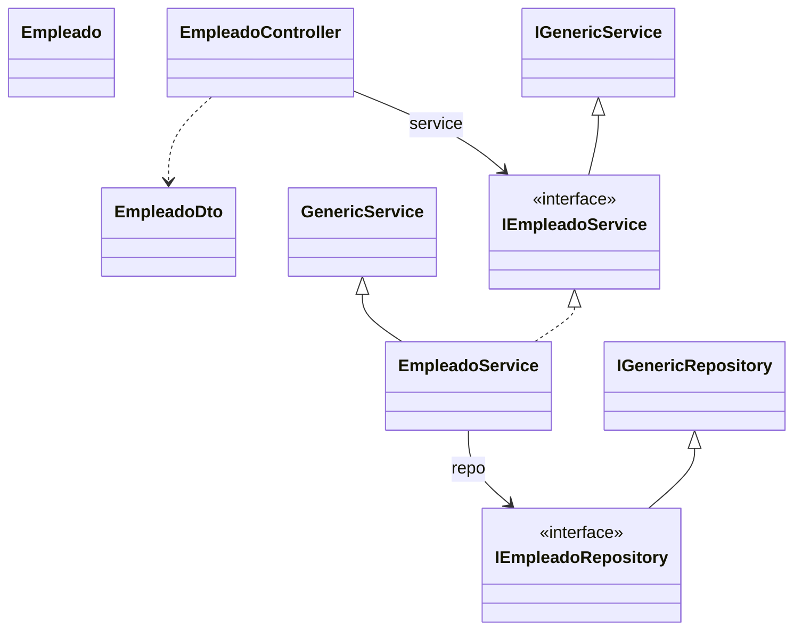

### Empleado

| Campo | Tipo |
|---|---|
| `idEmpleado` | `Integer` |
| `nombres` | `String` |
| `apellidos` | `String` |
| `dni` | `String` |
| `telefono` | `String` |
| `cargo` | `String` |
| `estado` | `String` |
| `producciones` | `List<Produccion>` |
| `mantenimientos` | `List<Mantenimiento>` |
| `alquileres` | `List<Alquiler>` |
| `devoluciones` | `List<Devolucion>` |

### EmpleadoDto

| Campo | Tipo |
|---|---|
| `idEmpleado` | `Integer` |
| `nombres` | `String` |
| `apellidos` | `String` |
| `dni` | `String` |
| `telefono` | `String` |
| `cargo` | `String` |
| `estado` | `String` |

### EmpleadoController

| Campo | Tipo |
|---|---|
| `service` | `IEmpleadoService` |
| `modelMapper` | `ModelMapper` |

| Método declarado | Retorno |
|---|---|
| `findAll()` | `ResponseEntity<List<EmpleadoDto>>` |
| `findById(Integer id)` | `ResponseEntity<EmpleadoDto>` |
| `save(EmpleadoDto empleado)` | `ResponseEntity<EmpleadoDto>` |
| `update(Integer id, EmpleadoDto empleado)` | `ResponseEntity<EmpleadoDto>` |
| `deleteById(Integer id)` | `ResponseEntity<Void>` |

### IEmpleadoService

Sin campos ni métodos propios declarados.

### EmpleadoService

| Campo | Tipo |
|---|---|
| `repo` | `IEmpleadoRepository` |

| Método declarado | Retorno |
|---|---|
| `getRepo()` | `IGenericRepository<Empleado, Integer>` |

### IEmpleadoRepository

Sin campos ni métodos propios declarados.

## Módulo de Mantenimiento

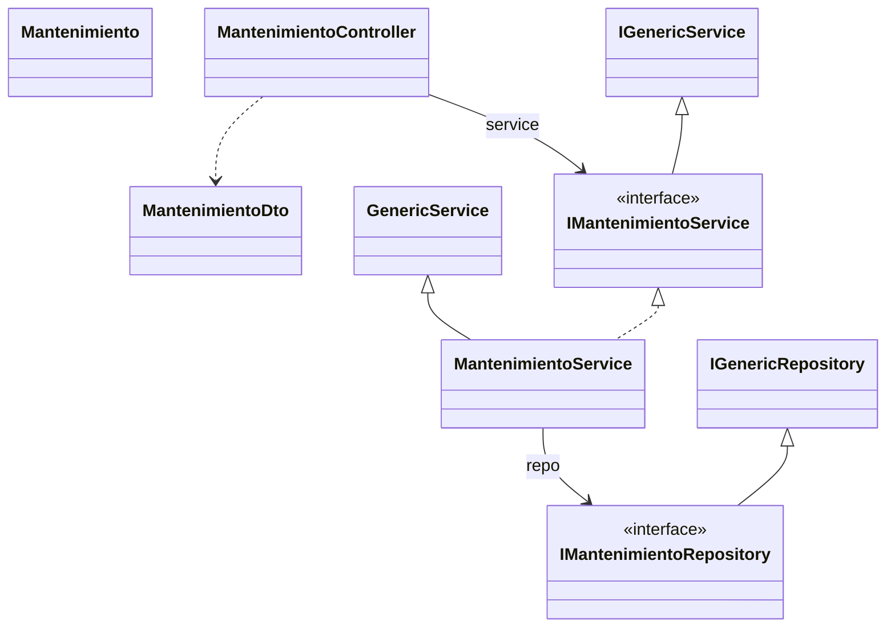

### Mantenimiento

| Campo | Tipo |
|---|---|
| `idMantenimiento` | `Integer` |
| `fechaInicio` | `LocalDate` |
| `fechaFin` | `LocalDate` |
| `tipoMantenimiento` | `String` |
| `descripcion` | `String` |
| `costo` | `BigDecimal` |
| `estado` | `String` |
| `prenda` | `Prenda` |
| `empleado` | `Empleado` |

### MantenimientoDto

| Campo | Tipo |
|---|---|
| `idMantenimiento` | `Integer` |
| `fechaInicio` | `LocalDate` |
| `fechaFin` | `LocalDate` |
| `tipoMantenimiento` | `String` |
| `descripcion` | `String` |
| `costo` | `BigDecimal` |
| `estado` | `String` |
| `prendaId` | `Integer` |
| `empleadoId` | `Integer` |

### MantenimientoController

| Campo | Tipo |
|---|---|
| `service` | `IMantenimientoService` |
| `modelMapper` | `ModelMapper` |

| Método declarado | Retorno |
|---|---|
| `findAll()` | `ResponseEntity<List<MantenimientoDto>>` |
| `findById(Integer id)` | `ResponseEntity<MantenimientoDto>` |
| `save(MantenimientoDto mantenimiento)` | `ResponseEntity<MantenimientoDto>` |
| `update(Integer id, MantenimientoDto mantenimiento)` | `ResponseEntity<MantenimientoDto>` |
| `deleteById(Integer id)` | `ResponseEntity<Void>` |

### IMantenimientoService

Sin campos ni métodos propios declarados.

### MantenimientoService

| Campo | Tipo |
|---|---|
| `repo` | `IMantenimientoRepository` |

| Método declarado | Retorno |
|---|---|
| `getRepo()` | `IGenericRepository<Mantenimiento, Integer>` |

### IMantenimientoRepository

Sin campos ni métodos propios declarados.

## Módulo de Pago

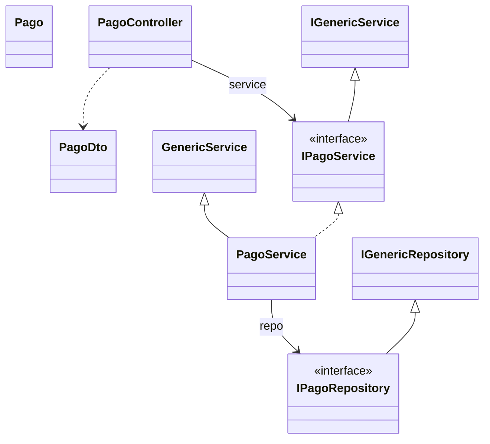

### Pago

| Campo | Tipo |
|---|---|
| `idPago` | `Integer` |
| `fechaPago` | `LocalDate` |
| `monto` | `BigDecimal` |
| `metodoPago` | `String` |
| `estado` | `String` |
| `alquiler` | `Alquiler` |

### PagoDto

| Campo | Tipo |
|---|---|
| `idPago` | `Integer` |
| `fechaPago` | `LocalDate` |
| `monto` | `BigDecimal` |
| `metodoPago` | `String` |
| `estado` | `String` |
| `alquilerId` | `Integer` |

### PagoController

| Campo | Tipo |
|---|---|
| `service` | `IPagoService` |
| `modelMapper` | `ModelMapper` |

| Método declarado | Retorno |
|---|---|
| `findAll()` | `ResponseEntity<List<PagoDto>>` |
| `findById(Integer id)` | `ResponseEntity<PagoDto>` |
| `save(PagoDto pago)` | `ResponseEntity<PagoDto>` |
| `update(Integer id, PagoDto pago)` | `ResponseEntity<PagoDto>` |
| `deleteById(Integer id)` | `ResponseEntity<Void>` |

### IPagoService

Sin campos ni métodos propios declarados.

### PagoService

| Campo | Tipo |
|---|---|
| `repo` | `IPagoRepository` |

| Método declarado | Retorno |
|---|---|
| `getRepo()` | `IGenericRepository<Pago, Integer>` |

### IPagoRepository

Sin campos ni métodos propios declarados.

## Módulo de Penalidad

### Penalidad

| Campo | Tipo |
|---|---|
| `idPenalidad` | `Integer` |
| `tipo_penalidad` | `String` |
| `descripcion` | `String` |
| `monto` | `java.math.BigDecimal` |
| `fecha_penalidad` | `LocalDateTime` |
| `estado` | `Boolean` |
| `devolucion` | `Devolucion` |

### PenalidadDto

| Campo | Tipo |
|---|---|
| `idPenalidad` | `Integer` |
| `tipo_penalidad` | `String` |
| `descripcion` | `String` |
| `monto` | `java.math.BigDecimal` |
| `fecha_penalidad` | `LocalDateTime` |
| `estado` | `Boolean` |
| `devolucionId` | `Integer` |

### PenalidadController

| Campo | Tipo |
|---|---|
| `service` | `IPenalidadService` |
| `modelMapper` | `ModelMapper` |

| Método declarado | Retorno |
|---|---|
| `findAll()` | `ResponseEntity<List<PenalidadDto>>` |
| `findById(Integer id)` | `ResponseEntity<PenalidadDto>` |
| `save(PenalidadDto penalidad)` | `ResponseEntity<PenalidadDto>` |
| `update(Integer id, PenalidadDto penalidad)` | `ResponseEntity<PenalidadDto>` |
| `deleteById(Integer id)` | `ResponseEntity<Void>` |

### IPenalidadService

Sin campos ni métodos propios declarados.

### PenalidadService

| Campo | Tipo |
|---|---|
| `repo` | `IPenalidadRepository` |

| Método declarado | Retorno |
|---|---|
| `getRepo()` | `IGenericRepository<Penalidad, Integer>` |

### IPenalidadRepository

Sin campos ni métodos propios declarados.

## Módulo de Prenda

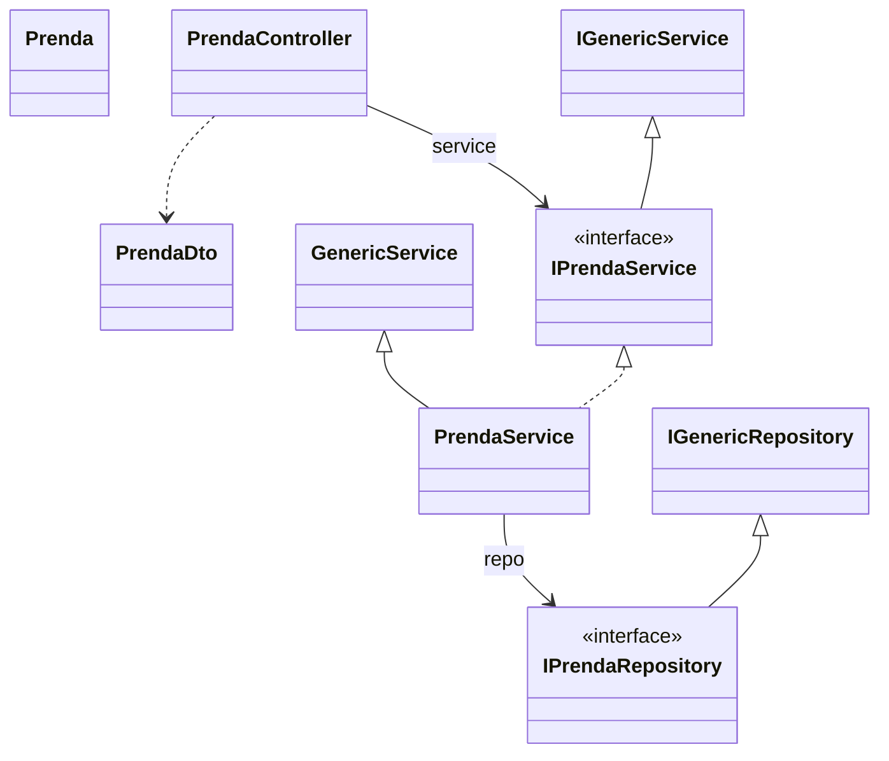

### Prenda

| Campo | Tipo |
|---|---|
| `idPrenda` | `Integer` |
| `nombre` | `String` |
| `descripcion` | `String` |
| `talla` | `String` |
| `color` | `String` |
| `precioAlquiler` | `BigDecimal` |
| `estado` | `String` |
| `categoria` | `Categoria` |
| `producciones` | `List<Produccion>` |
| `mantenimientos` | `List<Mantenimiento>` |
| `detallesAlquiler` | `List<DetalleAlquiler>` |

### PrendaDto

| Campo | Tipo |
|---|---|
| `idPrenda` | `Integer` |
| `nombre` | `String` |
| `descripcion` | `String` |
| `talla` | `String` |
| `color` | `String` |
| `precioAlquiler` | `BigDecimal` |
| `estado` | `String` |
| `categoriaNombre` | `String` |
| `categoriaId` | `Integer` |

### PrendaController

| Campo | Tipo |
|---|---|
| `service` | `IPrendaService` |
| `modelMapper` | `ModelMapper` |

| Método declarado | Retorno |
|---|---|
| `findAll()` | `ResponseEntity<List<PrendaDto>>` |
| `findById(Integer id)` | `ResponseEntity<PrendaDto>` |
| `save(PrendaDto prenda)` | `ResponseEntity<PrendaDto>` |
| `update(Integer id, PrendaDto prenda)` | `ResponseEntity<PrendaDto>` |
| `deleteById(Integer id)` | `ResponseEntity<Void>` |

### IPrendaService

Sin campos ni métodos propios declarados.

### PrendaService

| Campo | Tipo |
|---|---|
| `repo` | `IPrendaRepository` |

| Método declarado | Retorno |
|---|---|
| `getRepo()` | `IGenericRepository<Prenda, Integer>` |

### IPrendaRepository

Sin campos ni métodos propios declarados.

## Módulo de Produccion

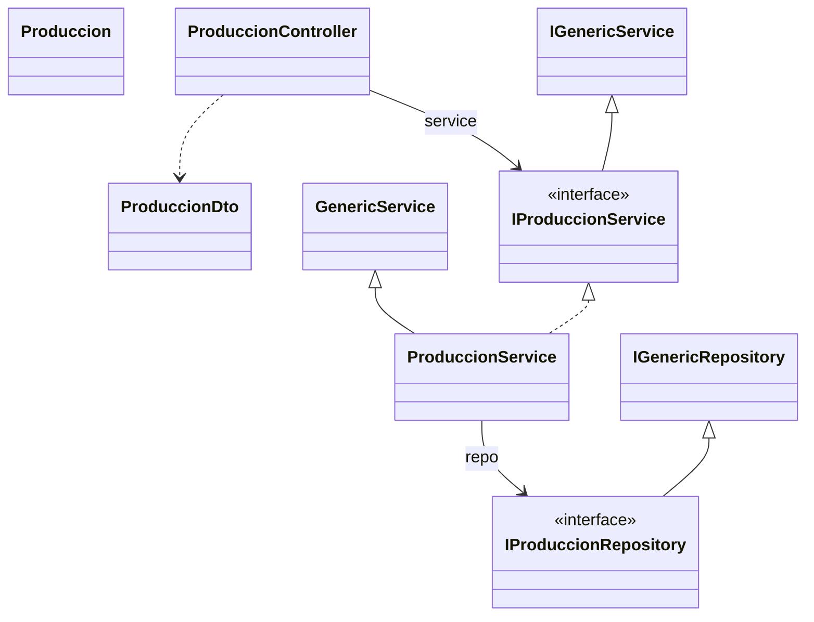

### Produccion

| Campo | Tipo |
|---|---|
| `idProduccion` | `Integer` |
| `fechaProduccion` | `LocalDate` |
| `cantidad` | `int` |
| `costoProduccion` | `BigDecimal` |
| `descripcion` | `String` |
| `prenda` | `Prenda` |
| `empleado` | `Empleado` |

### ProduccionDto

| Campo | Tipo |
|---|---|
| `idProduccion` | `Integer` |
| `fechaProduccion` | `LocalDate` |
| `cantidad` | `int` |
| `costoProduccion` | `BigDecimal` |
| `descripcion` | `String` |
| `idPrenda` | `Integer` |
| `idEmpleado` | `Integer` |

### ProduccionController

| Campo | Tipo |
|---|---|
| `service` | `IProduccionService` |
| `modelMapper` | `ModelMapper` |

| Método declarado | Retorno |
|---|---|
| `findAll()` | `ResponseEntity<List<ProduccionDto>>` |
| `findById(Integer id)` | `ResponseEntity<ProduccionDto>` |
| `save(ProduccionDto produccion)` | `ResponseEntity<ProduccionDto>` |
| `update(Integer id, ProduccionDto produccion)` | `ResponseEntity<ProduccionDto>` |
| `deleteById(Integer id)` | `ResponseEntity<Void>` |

### IProduccionService

Sin campos ni métodos propios declarados.

### ProduccionService

| Campo | Tipo |
|---|---|
| `repo` | `IProduccionRepository` |

| Método declarado | Retorno |
|---|---|
| `getRepo()` | `IGenericRepository<Produccion, Integer>` |

### IProduccionRepository

Sin campos ni métodos propios declarados.

## Módulo de Rol

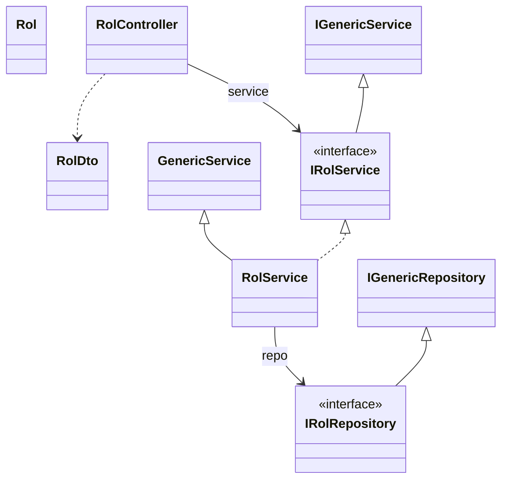

### Rol

| Campo | Tipo |
|---|---|
| `idRol` | `Integer` |
| `name` | `String` |
| `description` | `String` |
| `usuarios` | `List<Usuario>` |

### RolDto

| Campo | Tipo |
|---|---|
| `idRol` | `Integer` |
| `name` | `String` |
| `description` | `String` |

### RolController

| Campo | Tipo |
|---|---|
| `service` | `IRolService` |
| `modelMapper` | `ModelMapper` |

| Método declarado | Retorno |
|---|---|
| `findAll()` | `ResponseEntity<List<RolDto>>` |
| `findById(Integer id)` | `ResponseEntity<RolDto>` |
| `save(RolDto rol)` | `ResponseEntity<RolDto>` |
| `update(Integer id, RolDto rol)` | `ResponseEntity<RolDto>` |
| `deleteById(Integer id)` | `ResponseEntity<Void>` |

### IRolService

Sin campos ni métodos propios declarados.

### RolService

| Campo | Tipo |
|---|---|
| `repo` | `IRolRepository` |

| Método declarado | Retorno |
|---|---|
| `getRepo()` | `IGenericRepository<Rol, Integer>` |

### IRolRepository

Sin campos ni métodos propios declarados.

## Módulo de Usuario

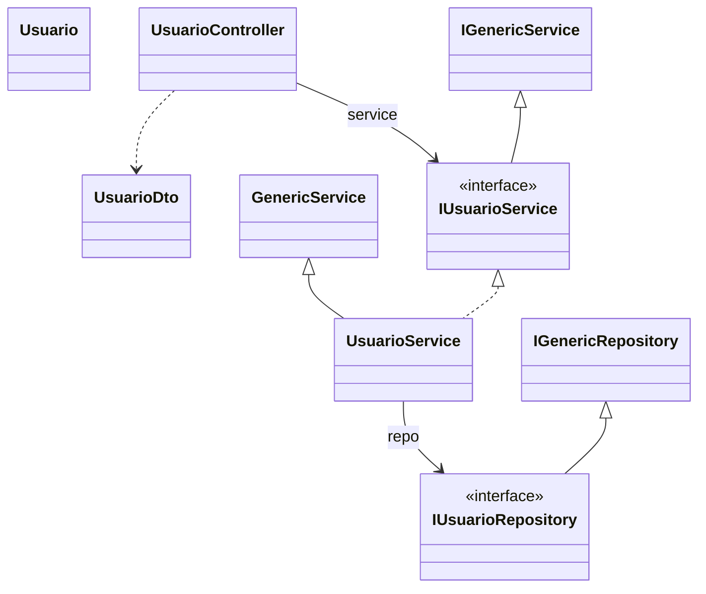

### Usuario

| Campo | Tipo |
|---|---|
| `idUser` | `Integer` |
| `username` | `String` |
| `password` | `String` |
| `enabled` | `boolean` |
| `rol` | `Rol` |

### UsuarioDto

| Campo | Tipo |
|---|---|
| `idUser` | `Integer` |
| `username` | `String` |
| `password` | `String` |
| `enabled` | `boolean` |
| `rolId` | `Integer` |
| `name` | `String` |

### UsuarioController

| Campo | Tipo |
|---|---|
| `service` | `IUsuarioService` |
| `modelMapper` | `ModelMapper` |

| Método declarado | Retorno |
|---|---|
| `findAll()` | `ResponseEntity<List<UsuarioDto>>` |
| `findById(Integer id)` | `ResponseEntity<UsuarioDto>` |
| `save(UsuarioDto usuario)` | `ResponseEntity<UsuarioDto>` |
| `update(Integer id, UsuarioDto usuario)` | `ResponseEntity<UsuarioDto>` |
| `deleteById(Integer id)` | `ResponseEntity<Void>` |

### IUsuarioService

Sin campos ni métodos propios declarados.

### UsuarioService

| Campo | Tipo |
|---|---|
| `repo` | `IUsuarioRepository` |
| `encoder` | `org.springframework.security.crypto.password.PasswordEncoder` |

| Método declarado | Retorno |
|---|---|
| `save(Usuario u)` | `Usuario` |
| `update(Integer id, Usuario u)` | `Usuario` |
| `validatePassword(String password)` | `void` |
| `getRepo()` | `IGenericRepository<Usuario, Integer>` |

### IUsuarioRepository

Sin campos ni métodos propios declarados.

## Autenticación y autorización

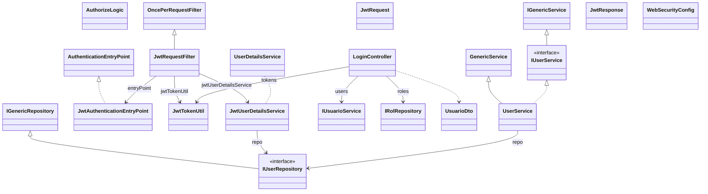

### AuthorizeLogic

| Método declarado | Retorno |
|---|---|
| `hasAccess(String method)` | `boolean` |

### IUserRepository

| Método declarado | Retorno |
|---|---|
| `findOneByUsername(String username)` | `Usuario` |
| `changePassword(String username, String newPassword)` | `void` |

### IUserService

| Método declarado | Retorno |
|---|---|
| `findOneByUsername(String username)` | `Usuario` |
| `changePassword(String username, String password)` | `void` |

### JwtAuthenticationEntryPoint

| Método declarado | Retorno |
|---|---|
| `commence(HttpServletRequest request, HttpServletResponse response, AuthenticationException authException)` | `void` |
| `convertObjectToJson(Object object)` | `String` |

### JwtRequest

| Campo | Tipo |
|---|---|
| `username` | `String` |
| `password` | `String` |

### JwtRequestFilter

| Campo | Tipo |
|---|---|
| `jwtTokenUtil` | `JwtTokenUtil` |
| `jwtUserDetailsService` | `JwtUserDetailsService` |
| `entryPoint` | `JwtAuthenticationEntryPoint` |

| Método declarado | Retorno |
|---|---|
| `doFilterInternal(HttpServletRequest request, HttpServletResponse response, FilterChain chain)` | `void` |

### JwtResponse

| Campo | Tipo |
|---|---|
| `accessToken` | `String` |

### JwtTokenUtil

| Campo | Tipo |
|---|---|
| `JWT_TOKEN_VALIDITY` | `long` |
| `secret` | `String` |

| Método declarado | Retorno |
|---|---|
| `validateConfiguration()` | `void` |
| `generateToken(UserDetails userDetails)` | `String` |
| `getAllClaimsFromToken(String token)` | `Claims` |
| `getUsernameFromToken(String token)` | `String` |
| `getExpirationDateFromToken(String token)` | `Date` |
| `isTokenExpired(String token)` | `boolean` |
| `validateToken(String token, UserDetails userDetails)` | `boolean` |

### JwtUserDetailsService

| Campo | Tipo |
|---|---|
| `repo` | `IUserRepository` |

| Método declarado | Retorno |
|---|---|
| `loadUserByUsername(String username)` | `UserDetails` |

### LoginController

| Campo | Tipo |
|---|---|
| `auth` | `AuthenticationManager` |
| `tokens` | `JwtTokenUtil` |
| `users` | `IUsuarioService` |
| `roles` | `IRolRepository` |
| `mapper` | `ModelMapper` |

| Método declarado | Retorno |
|---|---|
| `login(JwtRequest request)` | `ResponseEntity<JwtResponse>` |
| `register(UsuarioDto dto)` | `ResponseEntity<UsuarioDto>` |

### UserService

| Campo | Tipo |
|---|---|
| `repo` | `IUserRepository` |
| `bcrypt` | `PasswordEncoder` |
| `usuarios` | `com.prueba.ProyectoAlquiler.service.interfaz.IUsuarioService` |

| Método declarado | Retorno |
|---|---|
| `save(Usuario u)` | `Usuario` |
| `update(Integer id, Usuario u)` | `Usuario` |
| `getRepo()` | `IGenericRepository<Usuario, Integer>` |
| `findOneByUsername(String username)` | `Usuario` |
| `changePassword(String username, String newPassword)` | `void` |

### WebSecurityConfig

| Método declarado | Retorno |
|---|---|
| `passwordEncoder()` | `PasswordEncoder` |
| `authenticationManager(JwtUserDetailsService users, PasswordEncoder encoder)` | `AuthenticationManager` |
| `filterChain(HttpSecurity http, JwtRequestFilter filter, JwtAuthenticationEntryPoint entry)` | `SecurityFilterChain` |

## Configuración y arranque

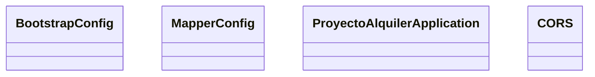

### BootstrapConfig

| Método declarado | Retorno |
|---|---|
| `bootstrap(IRolRepository roles, IUserRepository repo, IUsuarioService users, String password, String username)` | `CommandLineRunner` |

### MapperConfig

| Método declarado | Retorno |
|---|---|
| `defaultMapper()` | `ModelMapper` |
| `alquilerMapper()` | `ModelMapper` |
| `detalleAlquilerMapper()` | `ModelMapper` |
| `categoriaMapper()` | `ModelMapper` |
| `clienteMapper()` | `ModelMapper` |
| `devolucionMapper()` | `ModelMapper` |
| `empleadoMapper()` | `ModelMapper` |
| `mantenimientoMapper()` | `ModelMapper` |
| `pagoMapper()` | `ModelMapper` |
| `penalidadMapper()` | `ModelMapper` |
| `prendaMapper()` | `ModelMapper` |
| `produccionMapper()` | `ModelMapper` |
| `rolMapper()` | `ModelMapper` |
| `usuarioMapper()` | `ModelMapper` |
| `reference(java.util.function.Supplier<E> constructor, java.util.function.BiConsumer<E, I> setter)` | `Converter<I, E>` |

### ProyectoAlquilerApplication

| Método declarado | Retorno |
|---|---|
| `main(String[] args)` | `void` |

### CORS

| Método declarado | Retorno |
|---|---|
| `corsConfigurationSource(List<String> origins)` | `CorsConfigurationSource` |

## Manejo de errores

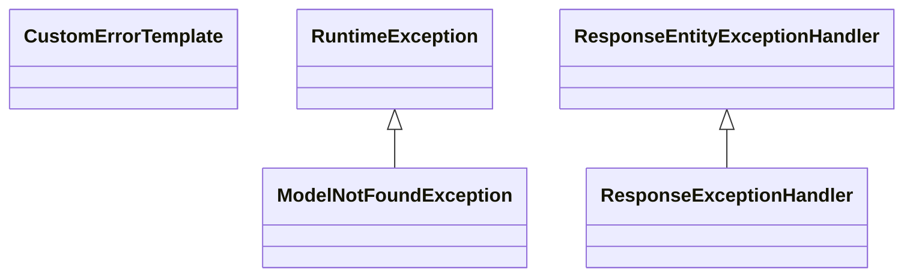

### CustomErrorTemplate

| Campo | Tipo |
|---|---|
| `datetime` | `LocalDateTime` |
| `message` | `String` |
| `details` | `String` |

### ModelNotFoundException

Sin campos ni métodos propios declarados.

### ResponseExceptionHandler

| Método declarado | Retorno |
|---|---|
| `handleDefaultException(Exception ex, WebRequest request)` | `ResponseEntity<CustomErrorTemplate>` |
| `handleModelNotFoundException(ModelNotFoundException ex, WebRequest request)` | `ResponseEntity<CustomErrorTemplate>` |
| `auth(Exception ex, WebRequest r)` | `ResponseEntity<CustomErrorTemplate>` |
| `denied(Exception ex, WebRequest r)` | `ResponseEntity<CustomErrorTemplate>` |
| `invalid(Exception ex, WebRequest r)` | `ResponseEntity<CustomErrorTemplate>` |
| `conflict(Exception ex, WebRequest r)` | `ResponseEntity<CustomErrorTemplate>` |
| `error(int status, String message, WebRequest r)` | `ResponseEntity<CustomErrorTemplate>` |
| `handleArithmeticException(ArithmeticException ex, WebRequest request)` | `ResponseEntity<CustomErrorTemplate>` |
| `handleMethodArgumentNotValid(MethodArgumentNotValidException ex, HttpHeaders headers, HttpStatusCode status, WebRequest request)` | `ResponseEntity<Object>` |
